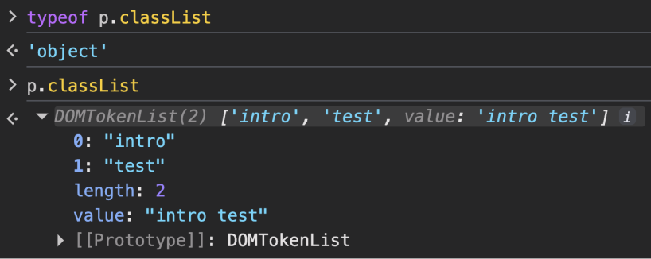

# JS230 Topics

Q. When is the DOM different than the HTML?
- when there are mistakes in the HTML and the browser has fixed them for you.
- Let’s say you have a `<table>` element in your HTML and leave out the required `<tbody>` element. The browser will just insert that `<tbody>` for you.
- It will be there in the DOM, so you’ll be able to find it with JavaScript and style it with CSS, even though it’s not in your HTML. (!!!!!)

## Javascript vs. the DOM
- JavaScript is a language that the browser reads and does stuff with.
- But the DOM is where that stuff happens. 
- In fact a lot of what you might think of as a “JavaScript Thing” is more accurately a “DOM API”.
- The DOM is the lifeblood here. It’s where everything goes down in the browser. 
    - JavaScript is just the syntax, the language. 
    - It (Javascript) can be used totally outside the browser with no DOM APIs at all (see Node.js)

What is a node?
- in the context of DOM, a node is a single point in the node tree, such as the document itself, HTML elements, text, and comments.

JS Methods to interact with DOM
- `querySelector`: returns the first node in the DOM that matches the specified CSS selector
- `querySelectorAll`: 
    - returns the `NodeList` of matching elements 
    
- `document` node
    - represents the entire HTML document
    - is the topmost node
- `toString` method
```javascript
document.toString()
// "[object HTMLDocument]"
```

***IMPORTANT***
- for `querySelector` and `querySelectorAll`:
    - both take multiple css selectors as an argument
    - The argument is a string of one or more comma-separated css selectors

```html
<div id="divOne"></div>
<div id="divTwo"></div>
```

```javascript
> document.querySelector('#divTwo, #divOne');
= <div id="divOne"></div>    // returns the first matching element;
                             // div with an id of `divOne` matched first
> document.querySelectorAll('#divTwo, #divOne');
= NodeList(2) [div#divOne, div#divTwo]
```


Node Properties
- `nodeName`
    - contains a String that represents the node type
    - For Elements (anything that represents an HTML tag), this is the name of the corresponding tag in <b><span style='color: red;'>uppercase</span></b>
```javascript
> p.nodeName
= "P"
```

- For text nodes -- even empty nodes -- the `nodeName` is "#text". For comments, it's "#comment".
- For document itself, `nodeName` is "#document".

## What is empty node?
- text node containing nothing but whitespace.
- LS shows two different text node types for clarity, but, in fact, all text nodes are the same.
- Empty nodes typically arise from whitespace before and after tags in the HTML
    - for example, the gap between `</h1>` and `<p>` forms an empty node that contains a newline and two space characters. 

`nodeType` property
- to determine a node's type
- returns a number that matches a node type constant 

```javascript
> p.nodeType
= 1
```

Most common Node Types (make a table)
```table
Constant	       Value	Description
Node.ELEMENT_NODE	1	An Element representing an HTML tag
Node.TEXT_NODE	    3	A Text node
Node.COMMENT_NODE	8	A Comment node
Node.DOCUMENT_NODE	9	A Document node
```

`nodeValue` property
- references the value of a node
- Element nodes don't have values:
```javascript
> p.nodeValue
= null
```

- Text nodes have `nodeValue`
- For a text node, the `nodeValue` is the textual content of the node
```javascript
> let t = p.childNodes[0];
> t.nodeName;
= "#text"
> t.toString();
= "[object Text]"
> t.nodeValue
= "\n      To receive our weekly emails, enter your email address below.\n"
```

## DOM. Type of a Node
- `EventTarget` provides the event-handling behavior that supports interactive web applications. 
- `Node` provides common behavior to all nodes.
- `Text` and `Element` are the chief subtypes of Node.
    - `Text` nodes hold text.
    - `Element` nodes represent HTML tags.
- Most HTML tags map to specific element subtypes that inherit from HTMLElement.
- Other element types exist, such as SVGElement and its subtypes.

## DOM. Determining a Node type
Method 1 (`Object.getPrototypeOf()`)
- `Object.getPrototypeOf()`, returns the prototype of the specified DOM element
- ie.
```javascript
> Object.getPrototypeOf(p);
= HTMLParagraphElement {Symbol(Symbol.toStringTag): 'HTMLParagraphElement', onmouseenter: undefined, onmouseleave: undefined, constructor: ƒ}
```

Method 2 (`toString` method)
- ie.
```javascript
> p.toString();
= "[object HTMLParagraphElement]"
```
- For most nodes, the return value of toString and String is the node type's name, but not all node types behave so well. HTMLAnchorElement (an `<a>` tag), for instance, is different:
```javascript
> let a = document.querySelector('a');
> a
= <a href="http://domain.com/page">Page</a>
> a.toString();
= "http://domain.com/page"
```
- `HTMLAnchorElement` implements toString in a way that causes it to return the <u>URL from the link.</u> 
    - Customized toString methods like this exist for some other Elements as well.

Last but not least, use `instanceof` method
 If all you need to know, though, is whether a node is an Element, you can test it with instanceof Element:

```javascript
> p instanceof HTMLElement;
= true
> p instanceof Element;
= true
> p instanceof Node;
= true
> p instanceof SVGElement;
= false
```

## `tagName` property
- If you don't need to know the type name, you can use the `tagName` property to check its HTML tag name instead
```javascript
> p.tagName;
= "P"
```

## DOM. Traversing Nodes
### Properties of parent nodes:
| Parent Node Properties	| Value |
| -------- | -------- |
| childNodes | 	Live collection of all child nodes | 
| firstChild | 	childNodes[0] or null | 
| lastChild  | 	childNodes[childNodes.length - 1] or null | 

### Properties of child nodes:
| Child Node Properties	| Value |
| -------- | -------- |
| parentNode  | 	Immediate parent of this node | 
| nextSibling | 	parentNode.childNodes[n + 1] or null | 
| previousSibling  | 	parentNode.childNodes[n - 1] or null |

- All DOM nodes that represent elements have both parent and child nodes. 
- Thus, they have both sets of the above properties. 
- Whether a node has a non-null value for a given property, though, depends on the DOM that contains the node.

## DOM Recursive Functions and Traversing Nodes
Recursive functions 
- returns to the previous level of recursion when it's gone as far as it can.
- performs a bit of processing.
- calls itself with a "smaller" argument.

## Element attributes
- Developers can access the attributes of an Element using these methods

| Method | Description | Returns |
| -------- | -------- | -------- |
| getAttribute(name) | Retrieve value of attribute name | Value of attribute as string |
| setAttribute(name, newValue) | Set value of attribute name to newValue | undefined |
| hasAttribute(name) | Check whether element has attribute name | true or false |


## Attribute Properties
- We can access some attributes directly
- The DOM exposes these special attributes as properties of the Element: `id`, `name`, `title`, and `value`
    - We can FETCH the value for one of these properties or SET it to a new value using standard property access and assignment operations
- class attribute is similar but uses the `className` property since class is a JavaScript reserved word
```javascript
> p.className;
= "intro"
> p.className = 'outro';
```

`classList` attribute
- Working with the class attribute via `className` is inconvenient when elements have more than one class
```html
<button class="btn btn-lg btn-primary">Proceed</button>
```

Getting the list of classes for the `button`
```javascript
> button.className;
= "btn btn-lg btn-primary"
```

## `classList` and array-like DOMTokenList object
- array-like DOMTokenList object has these properties and methods

| Name	| Description |
| -------- | -------- |
| add(name)| 	Add class name to element| 
| remove(name)	| Remove class name from element| 
| toggle(name)	| Add class name to element if it doesn't exist, remove if it does exist| 
| contains(name)	| Return true or false depending on whether element has class name| 
| length	| The number of classes to which element belongs|

## `className` vs. `classList`
- `className` returns a string
- `classList` returns an object



## `style` and CSSStyleDeclaration object
- Element nodes also have a style attribute that has some special behavior. 
- The `style` attribute on an Element references a CSSStyleDeclaration Object
- We can use the style attribute to alter any CSS property
- To remove a CSS property, set the property to null with the style property:
```javascript
> h1.style.color = null;
```

(IMPORTANT)
- When a CSS property's name contains dashes, you must use a camelCased version of the name to access that property.
    - For example, to set a value for the line-height attribute, you assign a value to the `lineHeight` property:
```javascript
> h1.style.lineHeight = '3em';
```
(BUT WHY?)
- because dashes (hyphens) are interpreted as the subtraction operator in JavaScript syntax\
(ie)
```javascript
element.style.background-color = "red"; 
```
The JavaScript engine evaluates that statement as:
1. Get the value of element.style.background
2. Subtract (-) the value of the variable color
3. Try to assign "red" to the resulting mathematical expression

=> Because evaluating an expression on the left-side of an equals sign is illegal syntax, the engine throws a ReferenceError or SyntaxError
```javascript
NaN - color
// Uncaught ReferenceError: color is not defined
```
 

## `node.contains(otherNode)` method
- checks whether a specific DOM node is a descendent of a given node (including direct children, grandchildren, or the node itself)
    - Return Value: Returns a boolean (true or false)
    - Self-Contained: It returns true if you pass the node itself as the argument (a node is considered to contain itself)
    - Null Handling: If otherNode is null or undefined, it safely returns false rather than throwing an error

## `getElementsByTagName`, `getElementsByClassName`
| Method | Returns | 
| ------ | ------ | 
| document.getElementsByTagName(tagName) | `HTMLCollection` or `NodeList` of matching elements | 
| document.getElementsByClassName(className) | `HTMLCollection` or `NodeList` of matching elements | 

- One key way in which these methods differ from the one we wrote above is that they return array-like objects, not actual arrays.

## DOM 12. Traversing Elements 
| Parent Element Properties | Value | 
| ------ | ------ | 
| children | Live collection of all child elements |  
| firstElementChild | `children[0]` or null |  
| lastElementChild | `children[children.length - 1]` or null |  
| childElementCount | `children.length` |  

More..
| Child Element Properties | Value | 
| ------ | ------ | 
| nextElementSibling | `parentNode.children[n + 1]` or `null` |  
| previousElementSibling | `parentNode.children[n - 1]` or `null` |  

## textContent
- The `textContent` property provides access to the text

to change the value of text content:
```javascript
> document.querySelector('a').textContent = 'step backward';
= "step backward"
```

- Be careful when setting `textContent`
    - doing so removes all child nodes from the element and replaces them with a text node that contains the value:


## DOM 14. Creating and Moving DOM Nodes
| Node Creation Method | Returns | 
| ------ | ------ | 
| document.createElement(tagName) | A new Element node |  
| document.createTextNode(text) | A new Text node |  
| node.cloneNode(deepClone) | Returns a copy of node |  

- If `deepClone` is `true`, cloneNode makes copies of node and all its descendant nodes; otherwise, cloneNode merely copies node
- In most cases, you'll use `true` to get a copy of the node and its children.

### Adding Nodes to the DOM
You can append, insert, and replace nodes with methods on the node's parent:

| Parent Node Method | Description | 
| ------ | ------ | 
| parent.appendChild(node) | Append node to the end of parent.childNodes |  
| parent.insertBefore(node, targetNode) | Insert node into parent.childNodes before targetNode |  
| parent.replaceChild(node, targetNode) | Remove targetNode from parent.childNodes and insert node in its place |  

- `document.appendChild` causes an error. Use `document.body.appendChild` instead.

(IMPORTANT)
- <span style='font-weight: bold; color: pink;'>No Node may appear twice in the DOM. If you try to add a node that is already in the DOM, it gets removed from the original location.</span> Thus, you can move an existing node by inserting it where you want it.

These methods insert a node before, after, or within an Element:
| Element Insertion Method | Description |
| ------ | ----- |
| element.insertAdjacentElement(position, newElement) | Inserts newElement at position relative to element |
| element.insertAdjacentText(position, text) | Inserts Text node that contains text at position relative to element |  

`position` must be one of the following String values:
| Position | Description | 
| ------ | ------ | 
| "beforebegin" | Before the element | 
| "afterbegin" | Before the first child of the element | 
| "beforeend" | After the last child of the element | 
| "afterend" | After the element |

### Removing Nodes
- When you remove a node from the DOM, it becomes eligible for garbage collection unless you keep a reference to the node in a variable.

| Element Method | Description | 
| ------ | ------ | 
| node.remove() | Remove node from the DOM | 
| parent.removeChild(node) | Remove node from parent.childNodes | 


